# Terraform CI/CD Validation and Security Pipeline

A GitHub Actions pipeline that checks every Terraform change before it can merge. It catches configuration errors, security misconfigurations, overly broad IAM permissions, and risky deployment changes, and it blocks the merge until they are fixed or explicitly justified.

Built for a healthcare context, where infrastructure mistakes can expose patient data. All infrastructure in this repository is **synthetic** and is never deployed to a real AWS account.

## Why multiple layers

Each check catches something the others miss. In four of the five demonstrations below, at least one tool would have let the problem through on its own.

| Demo                                                                         | Bad change                                     | Caught by                  | What would have missed it      |
| ---------------------------------------------------------------------------- | ---------------------------------------------- | -------------------------- | ------------------------------ |
| [#8](https://github.com/ShrirangeshV26/terraform-security-pipeline/pull/8)   | Public S3 bucket                               | Trivy (4 high findings)    | n/a                            |
| [#9](https://github.com/ShrirangeshV26/terraform-security-pipeline/pull/9)   | IAM policy with `Action: "*"`, `Resource: "*"` | Checkov (9 IAM violations) | Trivy passed it                |
| [#10](https://github.com/ShrirangeshV26/terraform-security-pipeline/pull/10) | Typo in the database instance type             | TFLint                     | `terraform validate` passed it |
| [#11](https://github.com/ShrirangeshV26/terraform-security-pipeline/pull/11) | Scanner exception with no reason               | Exception check            | Checkov accepted it            |
| [#12](https://github.com/ShrirangeshV26/terraform-security-pipeline/pull/12) | Database deletion protection turned off        | Deployment safety tests    | Trivy only warned              |

## Pipeline

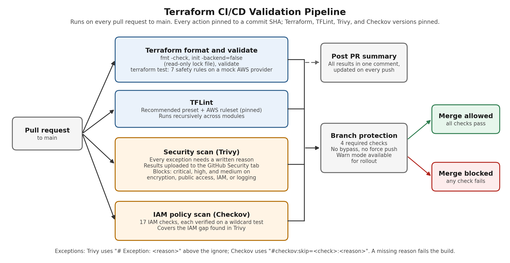

Every pull request to `main` runs four required checks. Branch protection blocks the merge if any of them fail, with no bypass.

| Check                             | What it does                                                                                                                                                                        |
| --------------------------------- | ----------------------------------------------------------------------------------------------------------------------------------------------------------------------------------- |
| **Terraform format and validate** | `terraform fmt -check`, `terraform init -backend=false` with a read-only lock file, `terraform validate`, and the deployment safety tests (`terraform test` on a mock AWS provider) |
| **TFLint**                        | Recommended Terraform rules plus the AWS ruleset, run recursively so it works across modules                                                                                        |
| **Security scan (Trivy)**         | Checks every exception has a written reason, scans for misconfigurations, uploads results to the GitHub Security tab, and applies the failure policy                                |
| **IAM policy scan (Checkov)**     | Runs 17 IAM checks to cover a gap in Trivy (see [Scanner coverage](#scanner-coverage))                                                                                              |

A summary comment is posted on every pull request and updated on each push, so results are visible without opening the logs.

## Failure policy

| Finding                                                                         | Result           |
| ------------------------------------------------------------------------------- | ---------------- |
| Critical or high (Trivy)                                                        | Blocks the merge |
| Medium involving encryption, public access, IAM permissions, or logging (Trivy) | Blocks the merge |
| Other medium and low (Trivy)                                                    | Warning only     |
| Any IAM policy violation (Checkov)                                              | Blocks the merge |
| Any deployment safety test failure                                              | Blocks the merge |
| Any exception without a written reason                                          | Blocks the merge |

**Warn mode:** setting the repository variable `SECURITY_ENFORCEMENT=warn` reports findings without blocking. This lets a team roll the pipeline out on existing, unreviewed Terraform first, then switch to `enforce` once the existing findings are fixed.

## Documented exceptions

Some findings are false positives in context. Skipping one requires a written reason in the code, and the pipeline fails if the reason is missing:

```hcl
# Trivy
# Exception: <why this rule does not apply>
#trivy:ignore:<check-id>

# Checkov
#checkov:skip=<check-id>:<why this rule does not apply>
```

The repository currently has five exceptions, all listed with their reasons in every pipeline run:

| Location    | Checks                | Reason                                                                                                                                       |
| ----------- | --------------------- | -------------------------------------------------------------------------------------------------------------------------------------------- |
| `kms.tf`    | CKV_AWS_109, 111, 356 | In a KMS key policy, `"*"` refers to the key itself. The root statement is AWS's default key policy.                                         |
| `lambda.tf` | CKV_AWS_111, 356      | Lambda creates its own VPC network interfaces, so their IDs aren't known in advance. AWS's managed policy grants these actions on `"*"` too. |

## Deployment safety tests

Scanners apply general severity ratings. These tests enforce rules specific to this platform that must never be broken. They run `terraform plan` against a mock AWS provider, so no AWS account or credentials are needed.

- Database deletion protection stays on, and a final snapshot is required
- Backups are kept at least 7 days, and the database stays Multi-AZ
- The database is never public, and its storage stays encrypted
- The documents bucket stays versioned
- Every log group keeps logs for at least 365 days
- KMS key rotation stays on, with the maximum 30-day deletion window
- An invalid environment name is rejected

## Supply-chain hardening

- Every GitHub Action is pinned to a full commit SHA, not a version tag. Tags can be moved to point at malicious code, which is what happened to `aquasecurity/trivy-action` in March 2026.
- Terraform, TFLint, the TFLint AWS ruleset, Trivy, and Checkov versions are all pinned.
- The provider lock file is committed with hashes for macOS and Linux, and CI initializes in read-only lock mode.
- Workflows run with read-only permissions by default. Jobs request only the extra permissions they need.

## Scanner coverage

Before trusting the scanners, I tested them with deliberate misconfigurations:

- A public S3 ACL setting: **Trivy caught it** (AWS-0086, high).
- A role policy with `Action: "*"`, `Resource: "*"`: **Trivy did not flag it**, whether written as an `aws_iam_policy_document` or as inline JSON.
- The same wildcard policy: **Checkov caught it** with multiple IAM checks.

Since overly broad IAM permissions are one of the biggest risks for a platform handling patient data, the pipeline runs Checkov's IAM checks as a separate blocking job. Each of the 17 check IDs was confirmed to fire on a wildcard test policy before being added. Trivy remains the main scanner for everything else.

## Synthetic infrastructure

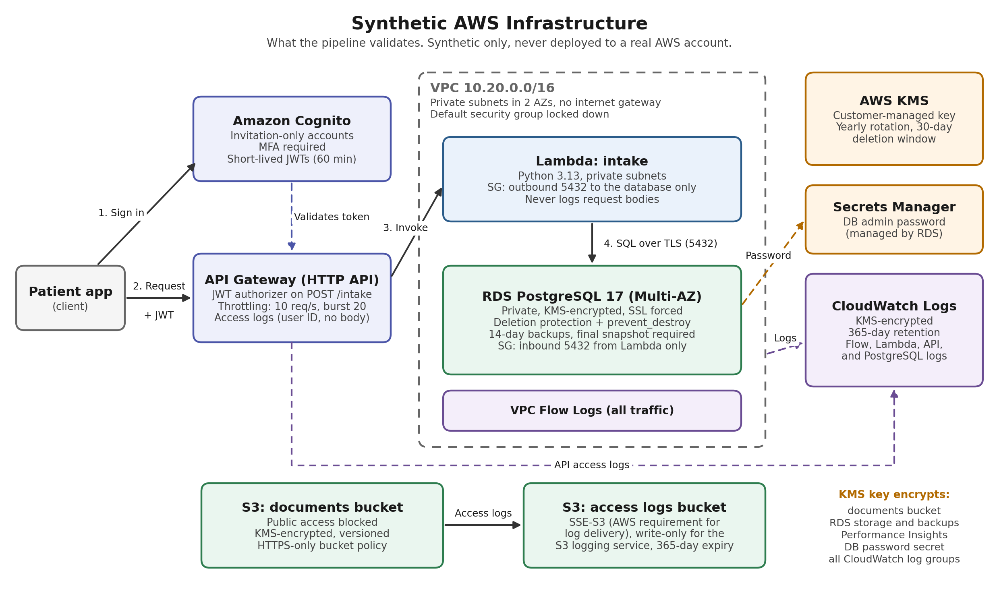

A small but realistic setup mirroring a healthcare platform's stack:

- **Amazon Cognito:** invitation-only accounts, MFA required, short-lived tokens
- **API Gateway (HTTP API):** JWT authorizer, throttling, access logs that never include request bodies
- **Lambda:** private subnets, can only reach the database, scoped IAM role
- **RDS PostgreSQL:** private, KMS-encrypted, SSL enforced, Multi-AZ, deletion protection, AWS-managed password
- **S3:** public access blocked, KMS-encrypted, versioned, HTTPS-only, access logging
- **Audit logging:** VPC flow logs, Lambda, API, and database logs, all KMS-encrypted and kept for 365 days

## Demonstrations

Each demo is a pull request that introduces a deliberate problem, shows the pipeline blocking it, then reverts the change and shows it passing. None of them were merged.

### 1. Public S3 bucket ([#8](https://github.com/ShrirangeshV26/terraform-security-pipeline/pull/8))

All four public access block settings on the documents bucket were turned off. Trivy flagged four high findings and blocked the merge.

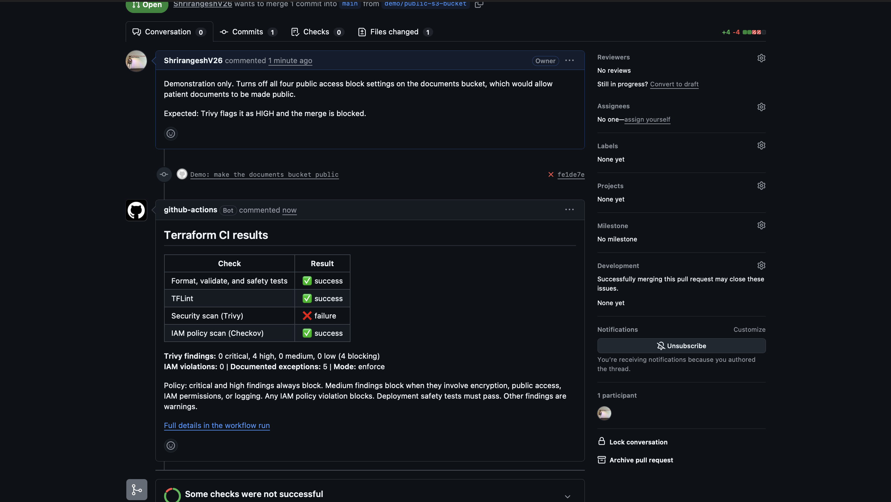

The job summary shows each finding with its exact line, along with the documented exceptions:

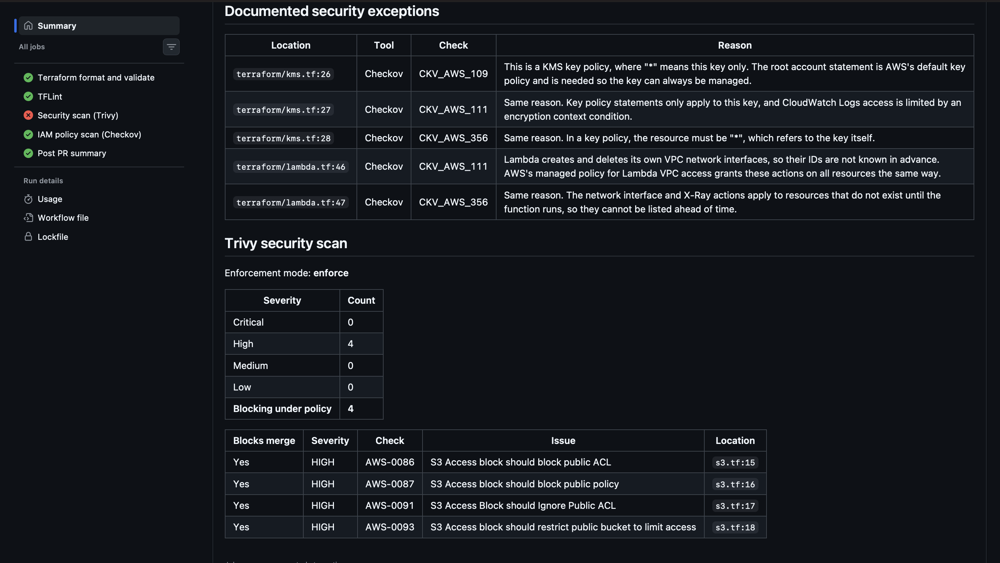

<details>
<summary>After the fix</summary>

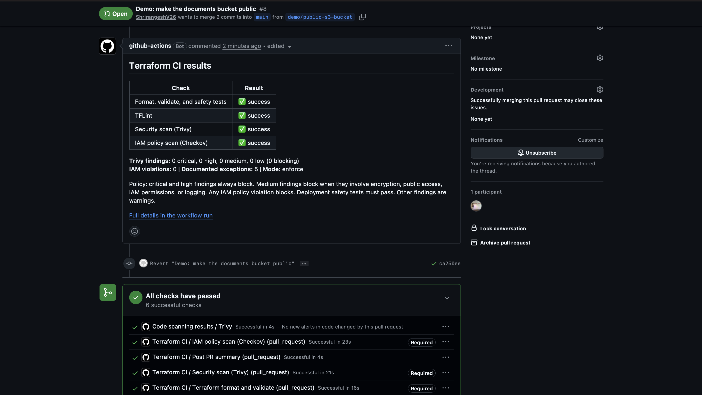

</details>

### 2. Wildcard IAM policy ([#9](https://github.com/ShrirangeshV26/terraform-security-pipeline/pull/9))

A role policy giving the Lambda full admin access. **Trivy passed it. Checkov blocked it** with nine IAM violations, including privilege escalation, data exfiltration, and credentials exposure.

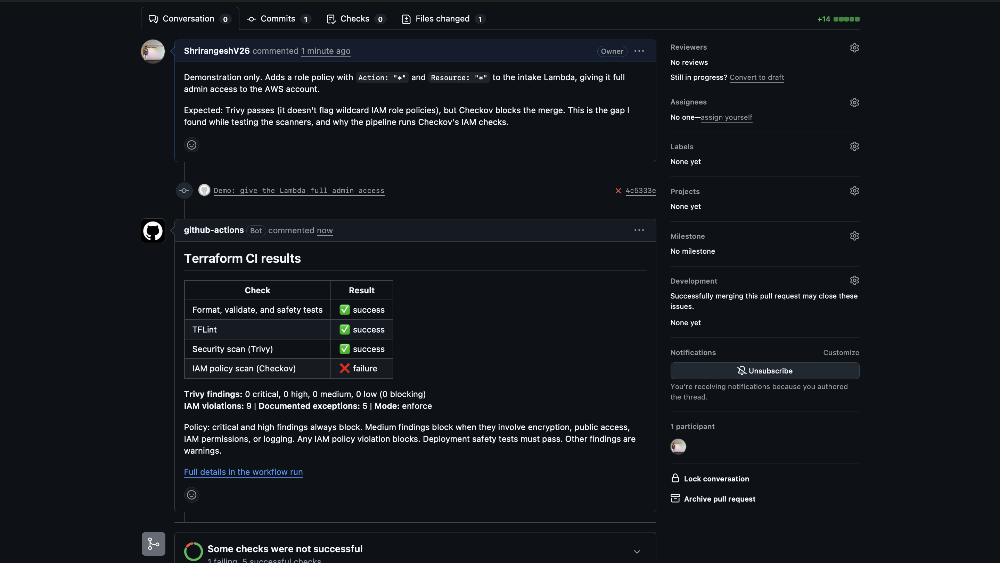

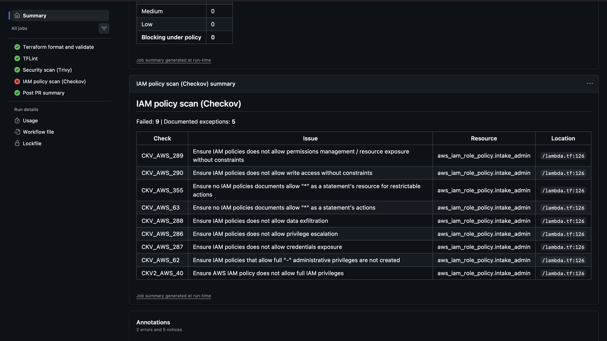

<details>
<summary>After the fix</summary>


</details>

### 3. Invalid instance type ([#10](https://github.com/ShrirangeshV26/terraform-security-pipeline/pull/10))

A typo in the database instance class. `terraform validate` passed, since Terraform doesn't check AWS's list of instance types. TFLint caught it before it could fail a deployment.

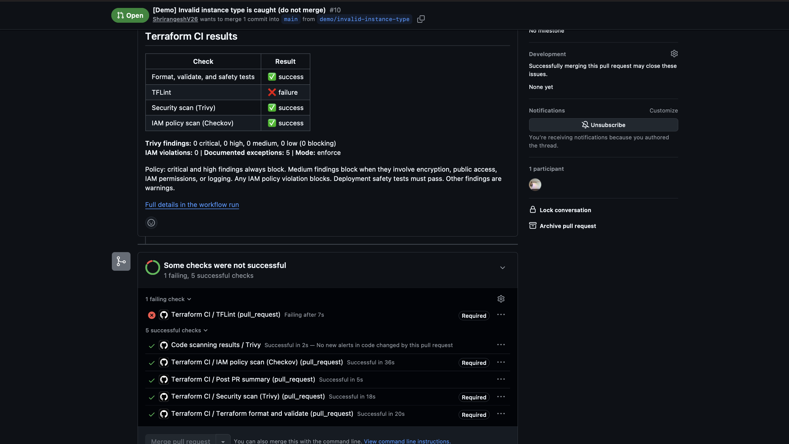

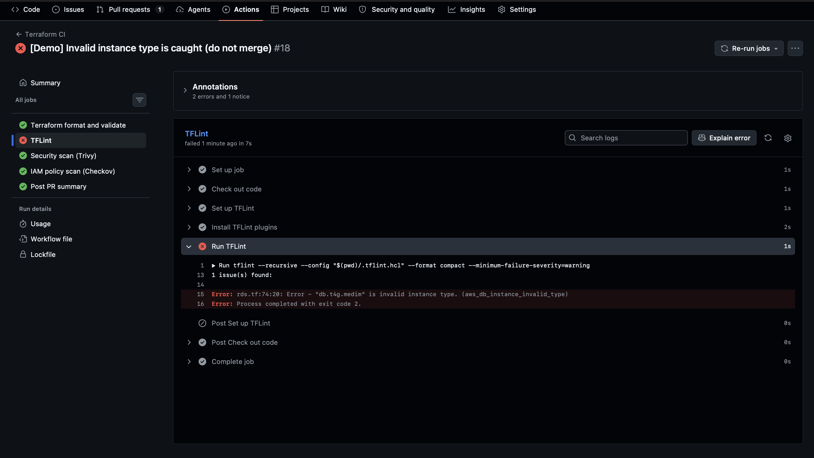

<details>
<summary>After the fix</summary>

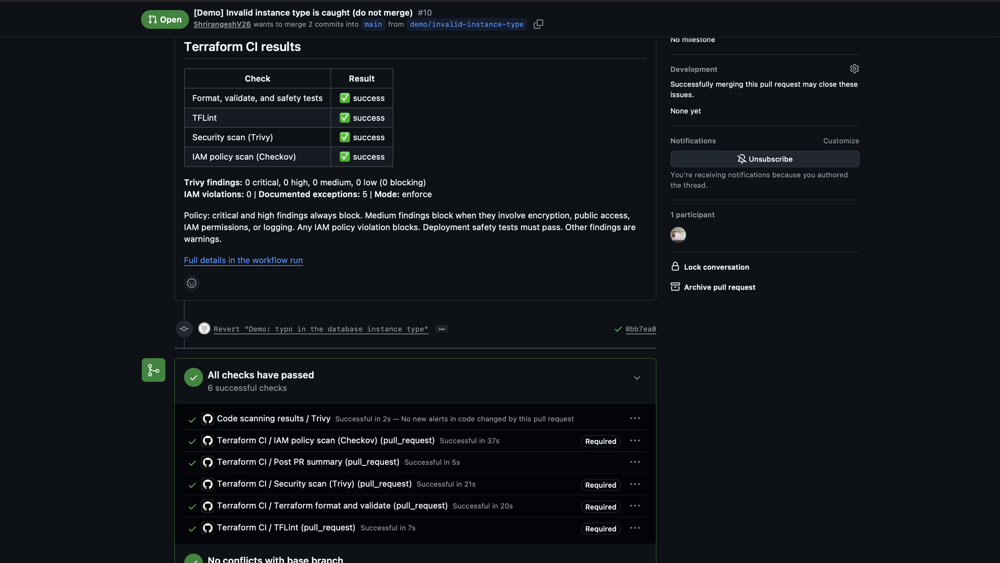

</details>

### 4. Exception without a reason ([#11](https://github.com/ShrirangeshV26/terraform-security-pipeline/pull/11))

The written reason was removed from one Checkov skip. Checkov itself accepted the skip, but the pipeline's exception check rejected it before the scan ran.

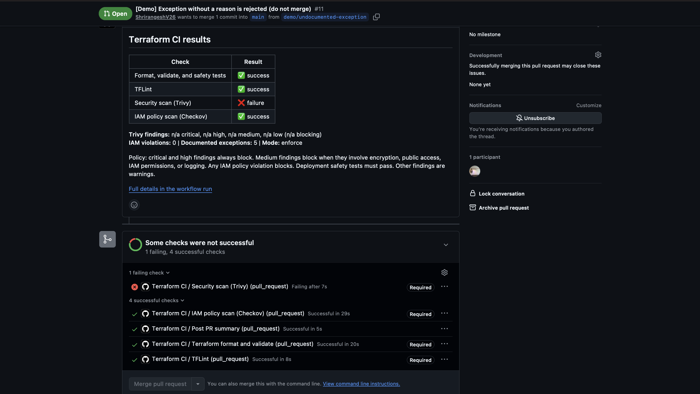

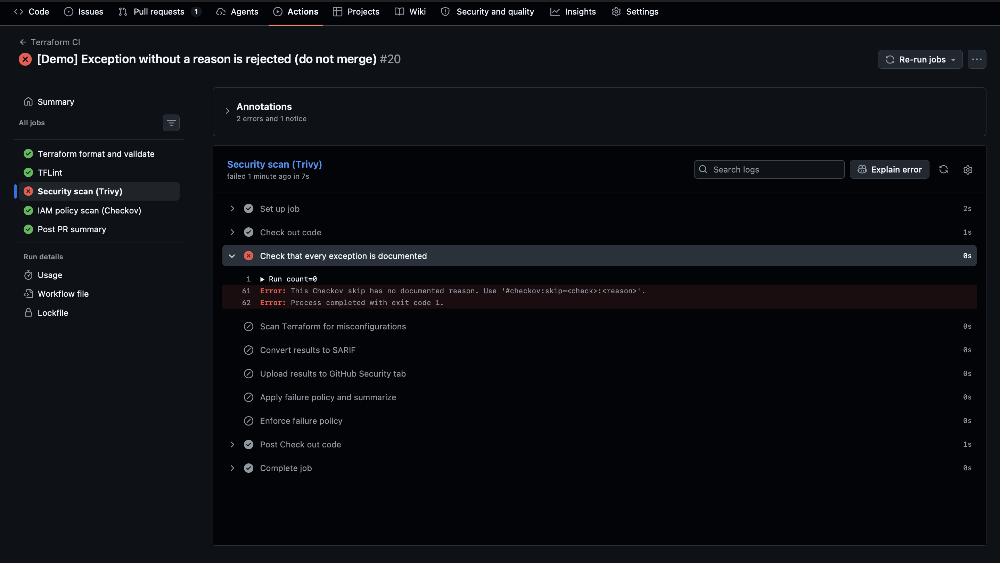

<details>
<summary>After the fix</summary>

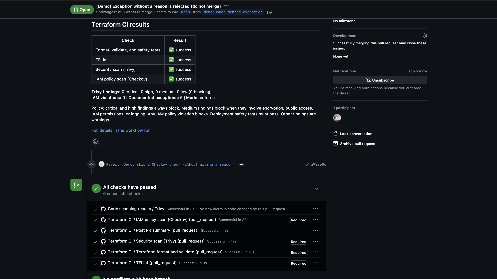

</details>

### 5. Deletion protection turned off ([#12](https://github.com/ShrirangeshV26/terraform-security-pipeline/pull/12))

Deletion protection was turned off on the database. Trivy noticed it but only warned, since it's a medium finding outside the blocking categories. The deployment safety test blocked it.

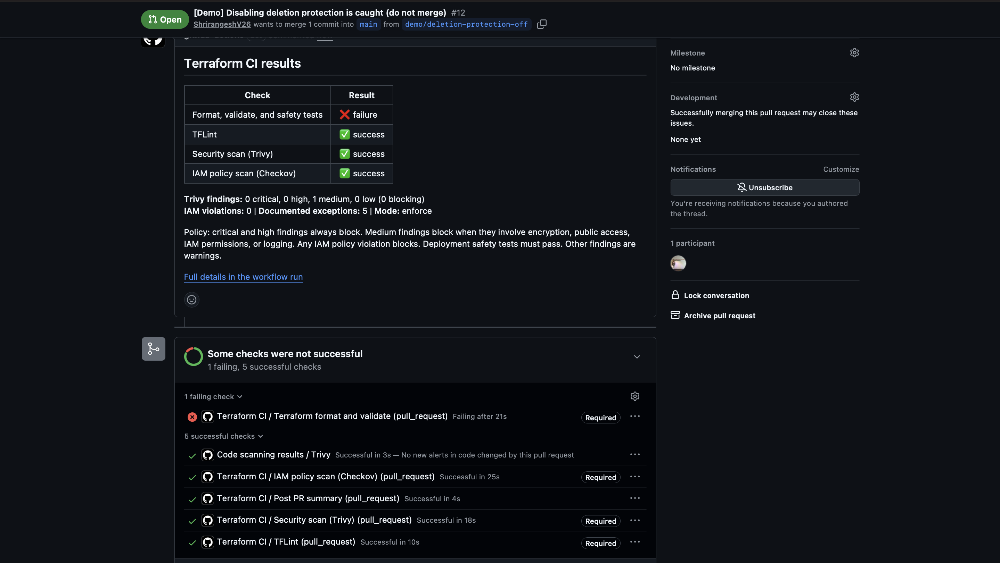

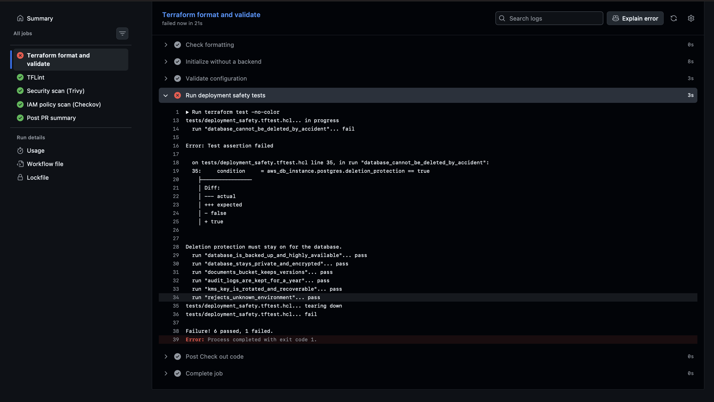

<details>
<summary>After the fix</summary>

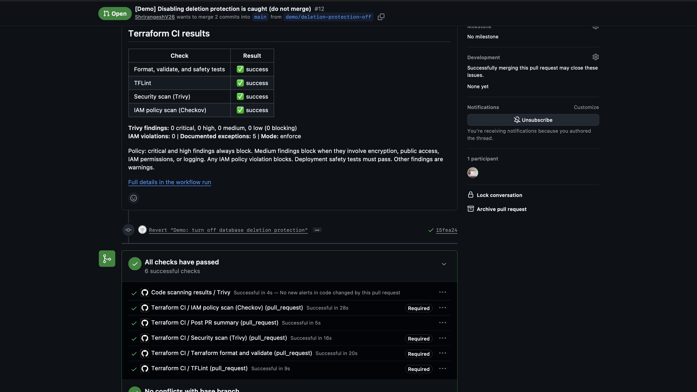

</details>

## Design decisions based on team input

Several choices came directly from feedback on how the team works and what matters for a platform handling patient data:

- **Medium findings block** when they involve encryption, public access, IAM permissions, or logging, not just critical and high.
- **Documented exceptions:** every skipped finding needs a written reason in the code.
- **Warn mode** for rolling the pipeline out on existing Terraform before enforcing it.
- **Demonstrations** focus on public or unencrypted storage and overly broad IAM policies, the risks most relevant to healthcare.

## Running the checks locally

```bash
cd terraform

terraform fmt -check -recursive
terraform init -backend=false
terraform validate
terraform test

tflint --init && tflint --recursive

trivy config .

checkov -d . --framework terraform --compact --quiet \
  --check CKV_AWS_1,CKV_AWS_49,CKV_AWS_62,CKV_AWS_63,CKV_AWS_107,CKV_AWS_108,CKV_AWS_109,CKV_AWS_110,CKV_AWS_111,CKV_AWS_286,CKV_AWS_287,CKV_AWS_288,CKV_AWS_289,CKV_AWS_290,CKV_AWS_355,CKV_AWS_356,CKV2_AWS_40
```

## Repository structure

```
.github/workflows/terraform-ci.yml   The pipeline
terraform/                           Synthetic AWS configuration
terraform/tests/                     Deployment safety tests
terraform/lambda/                    Intake Lambda handler
docs/architecture.md                 Architecture and integration document
docs/images/                         Diagrams and demo screenshots
```

## Architecture and integration

See [`docs/architecture.md`](docs/architecture.md) for how this pipeline would integrate with an existing AWS and Terraform repository, including state management, deployment permissions, drift detection, and additional healthcare controls.
